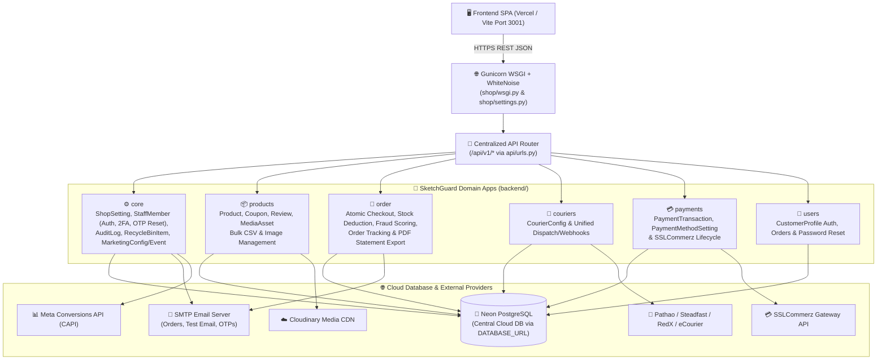
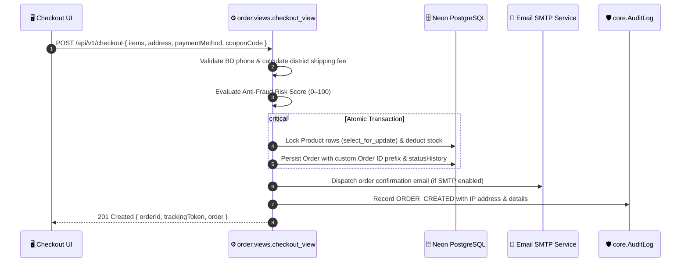
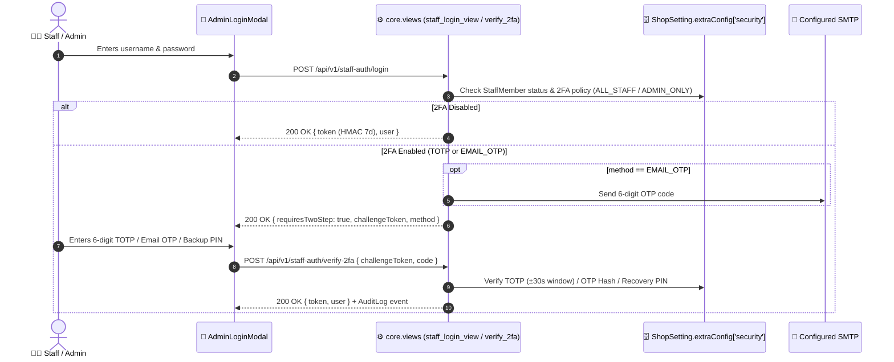
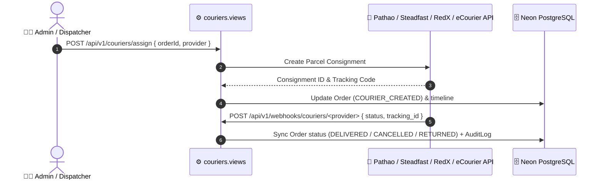

<div align="center">

# ⚙️ SketchGuard — Backend API Engine
### **Django REST Core, Neon PostgreSQL Persistence, Payment Gateways & Courier Hub**

[](https://www.djangoproject.com/)
[](https://www.django-rest-framework.org/)
[](https://neon.tech/)
[](https://cloudinary.com/)
[](https://render.com/)

<p align="center">
  <b>Modular Django REST Framework backend powering SketchGuard.</b><br/>
  Configured with the core Django package <code>shop</code>, virtual environment <code>shop_env</code>, central <b>Neon Serverless PostgreSQL</b> persistence, atomic checkout stock locking, fraud scoring, SSLCommerz gateway verification, Bangladesh courier integrations (Pathao, Steadfast, RedX, eCourier), Cloudinary media library, HMAC staff tokens with TOTP/Email 2FA, and a central database Recycle Bin.
</p>

</div>

---

## 🏗️ Backend Architecture

**SketchGuard Backend** follows a strict modular Django app architecture routed centrally under `/api/v1/` (`api.urls`), connected to **Neon PostgreSQL** via `DATABASE_URL` with PgBouncer pooler optimizations (`conn_max_age=60`, `conn_health_checks=True`, SSL enforcement, `DISABLE_SERVER_SIDE_CURSORS=True`).

### 1. Modular System & Integration Architecture



---

### 2. Atomic Checkout, Anti-Fraud Scoring & Notification Workflow



---

### 3. Staff Authentication, Two-Step Verification (2FA) & Password Recovery



---

### 4. Courier Assignment & Webhook Ingress



---

## 🗄️ Core Data Models (PostgreSQL ORM)

| App | Model | Key Fields & Responsibility |
|---|---|---|
| `core` | `ShopSetting` | Store identity, branding URLs, SMTP config, `extraConfig` JSON (header, footer, themesColors, campaign, security/2FA, idPrefixes) |
| `core` | `StaffMember` | Role-based staff accounts (`ADMIN`, `MANAGER`, `DISPATCHER`), `ACTIVE`/`SUSPENDED` status |
| `core` | `AuditLog` | Immutable security & operational trail with IP, actor, action, target |
| `core` | `RecycleBinItem` | Central soft-delete trash supporting single/bulk restore & permanent purge across 9 entity types |
| `core` | `MarketingConfig` & `MarketingEvent` | Meta Pixel, CAPI token, GA4 & server-side conversion logs |
| `products` | `Product`, `Coupon`, `Review`, `MediaAsset` | Product catalog (`360°` frames/video, variants, stock), discount coupons, reviews & Cloudinary assets |
| `order` | `Order` | Order totals, customer address JSON, fraud `riskScore`, `statusHistory`, courier & payment tracking |
| `couriers` | `CourierConfig` | Active toggle, API keys, secrets & webhook credentials per courier provider |
| `payments` | `PaymentTransaction`, `PaymentMethodSetting` | Payment channel configuration, SSLCommerz session/validation records & reconciliation |
| `users` | `CustomerProfile` | Customer accounts, saved BD addresses & hashed passwords |

---

## 📡 API Reference (`/api/v1/`)

### System, Settings, Staff, Security & Recycle Bin (`core`)
- `GET /api/v1/health` — Backend health & timestamp probe
- `GET, POST /api/v1/settings/shop` — Fetch or update global shop identity, theme, header, footer, prefixes & SMTP
- `POST /api/v1/settings/email/test` — Dispatch live SMTP verification test email
- `GET /api/v1/staff`, `POST /api/v1/staff` — List or create staff members
- `GET, PUT, PATCH, DELETE /api/v1/staff/<staff_id>` — Manage staff member or soft-delete to Recycle Bin
- `POST /api/v1/staff-auth/login` — Authenticate staff (returns HMAC token or `requiresTwoStep` challenge)
- `POST /api/v1/staff-auth/verify-2fa` — Complete TOTP, Email OTP, or Recovery PIN login verification
- `POST /api/v1/staff-auth/forgot-password` — Dispatch 6-digit password recovery OTP to staff email
- `POST /api/v1/staff-auth/reset-password` — Verify OTP & update staff password
- `GET /api/v1/staff-auth/verify` — Verify bearer staff token validity
- `GET, POST /api/v1/security/2fa` — Manage Two-Step Verification policy, Authenticator secret & Backup PIN
- `GET /api/v1/audit-logs`, `DELETE /api/v1/audit-logs/<pk>`, `POST /api/v1/audit-logs/bulk-delete` — Security audit trail & soft delete
- `GET, POST /api/v1/recycle-bin`, `POST /api/v1/recycle-bin/<pk>/restore`, `DELETE /api/v1/recycle-bin/<pk>`, `POST /api/v1/recycle-bin/bulk-restore`, `POST /api/v1/recycle-bin/bulk-delete`
- `GET, POST /api/v1/marketing/config`, `GET /api/v1/marketing/events`, `POST /api/v1/marketing/capi/event`, `POST /api/v1/marketing/sync-meta-ads`, `GET /api/v1/marketing/facebook-catalog.xml`

### Catalog, Media, Coupons & Reviews (`products`)
- `GET, POST /api/v1/products`, `GET, PUT, PATCH, DELETE /api/v1/products/<pk>`
- `POST /api/v1/products/bulk-upload-csv`, `POST /api/v1/products/bulk-delete`, `POST /api/v1/products/bulk-stock`, `POST /api/v1/products/reorder`
- `POST /api/v1/upload/image`, `POST /api/v1/upload/image/delete`, `GET, POST /api/v1/media`, `POST /api/v1/media/sync`, `GET, PUT, DELETE /api/v1/media/<pk>`
- `GET, POST /api/v1/coupons`, `GET, PUT, DELETE /api/v1/coupons/<code>`
- `GET, POST /api/v1/reviews`, `GET, PUT, DELETE /api/v1/reviews/<pk>`

### Checkout, Orders & Tracking (`order`)
- `POST /api/v1/checkout` — Create order & atomically deduct stock
- `GET /api/v1/orders`, `GET, PATCH, DELETE /api/v1/orders/<pk>`, `PATCH /api/v1/orders/<pk>/status`, `POST /api/v1/orders/bulk-delete`
- `GET /api/v1/orders/statement/pdf` — Download filtered order statements (weekly, 15-day, monthly, custom range)
- `POST /api/v1/tracking/lookup` — Public order tracking by Order ID & phone

### Couriers, Payments & Customers (`couriers`, `payments`, `users`)
- `GET /api/v1/couriers`, `PUT /api/v1/couriers/<pk>`, `POST /api/v1/couriers/assign`, `GET /api/v1/couriers/<provider>/balance`, `GET /api/v1/couriers/<provider>/status/<tracking_code>`
- `POST /api/v1/webhooks/couriers`, `POST /api/v1/webhooks/couriers/<provider>`
- `GET, POST /api/v1/payments/methods`, `GET, POST /api/v1/payments/config`, `POST /api/v1/payments/initiate`, `POST /api/v1/payments/verify`
- `POST /api/v1/payments/sslcommerz/{success|fail|cancel|ipn}`, `GET, POST /api/v1/payments/sslcommerz/sandbox-simulator`
- `GET /api/v1/payments/transactions`, `DELETE /api/v1/payments/transactions/<pk>`, `POST /api/v1/payments/transactions/bulk-delete`
- `POST /api/v1/users/auth`, `POST /api/v1/users/forgot-password`, `GET, PUT, PATCH /api/v1/users/<phone>`, `GET /api/v1/users/<phone>/orders`

---

## 💻 Backend Tech Stack

| Package / Tool | Version / Spec | Purpose |
|---|---|---|
| **Django** | `>=5.0,<6.0` (`5.2`) | Core web framework, ORM, migrations & admin |
| **Django REST Framework** | `>=3.15.0` | JSON API serialization & viewsets |
| **Neon PostgreSQL** | PostgreSQL 18 (Cloud) | Central relational + JSONB persistence (`DATABASE_URL`) |
| **`psycopg2-binary` & `dj-database-url`** | `>=2.9.9` / `>=2.1.0` | PostgreSQL driver & pooled SSL DSN parser |
| **`django-cors-headers`** | `>=4.3.0` | Cross-origin requests from Vercel/custom frontend domains |
| **`whitenoise`** | `>=6.6.0` | Production static file serving without external CDN |
| **`gunicorn`** | `>=21.2.0` | Production WSGI HTTP server |
| **`cloudinary` & `Pillow`** | `>=1.40.0` / `>=10.0.0` | Cloud image/video hosting & media processing |
| **`requests` & `python-dotenv`** | `>=2.31.0` / `>=1.0.0` | Courier/Payment/Meta HTTP calls & `.env` loading |

---

## 📁 Backend Directory Structure

```text
backend/
├── manage.py                     # Django CLI entrypoint (DJANGO_SETTINGS_MODULE=shop.settings)
├── requirements.txt              # Python production dependencies
├── build.sh                      # Render build script (pip install, collectstatic, migrate, seed_data)
├── passenger_wsgi.py             # Alternate cPanel Passenger WSGI entrypoint
├── .env.example                  # Backend environment variable template
├── .gitignore                    # Ignores shop_env/, .env*, db.sqlite3, media/, *.zip
├── shop_env/                     # Local Python virtual environment (gitignored)
├── shop/                         # Core Django project package
│   ├── settings.py               # Neon PostgreSQL DATABASE_URL, CORS, WhiteNoise, SSLCommerz, SMTP
│   ├── urls.py                   # Root URLs (/, /admin/, /api/v1/, /media/)
│   ├── wsgi.py                   # WSGI boot + auto-migrate/seed hook
│   └── asgi.py                   # ASGI entrypoint
├── api/                          # Centralized /api/v1/ router & system migrate probe
├── core/                         # ShopSetting, StaffMember, AuditLog, Security 2FA, RecycleBin, Marketing
├── products/                     # Catalog, Coupons, Reviews & Cloudinary Media Library
├── order/                        # Checkout, Anti-Fraud Scoring, Statements & Email Notifications
├── couriers/                     # Pathao, Steadfast, RedX & eCourier API adapters + webhooks
├── payments/                     # SSLCommerz & payment method/transaction management
└── users/                        # Customer authentication & password recovery
```

---

## 🚀 Local Setup & Render Deployment Guide

### Local Development
```powershell
# 1. Create & activate virtual environment
python -m venv shop_env
.\shop_env\Scripts\Activate.ps1

# 2. Install dependencies
pip install -r requirements.txt

# 3. Configure .env with your Neon DATABASE_URL & secrets, then migrate
python manage.py migrate
python manage.py check

# 4. Run development server
python manage.py runserver 127.0.0.1:8000
```

### Render Deployment (Recommended for Backend)
1. Push the `backend/` folder to its own GitHub repository.
2. Create a new **Web Service** on **Render**:
   - **Runtime:** `Python 3`
   - **Build Command:** `./build.sh`
   - **Start Command:** `gunicorn shop.wsgi:application`
3. Add **Environment Variables** on Render:
   - `DATABASE_URL` = Your Neon PostgreSQL pooled connection string (`?sslmode=require`)
   - `DJANGO_SECRET_KEY` = Strong random secret key
   - `DEBUG` = `False`
   - `ALLOWED_HOSTS` = `your-service.onrender.com` (or `*`)
   - `APP_URL` / `FRONTEND_URL` = `https://your-vercel-frontend.vercel.app`
   - `SSLCOMMERZ_FRONTEND_URL` = `https://your-vercel-frontend.vercel.app`
   - `SSLCOMMERZ_BACKEND_URL` = `https://your-service.onrender.com`
   - `CLOUDINARY_CLOUD_NAME`, `CLOUDINARY_API_KEY`, `CLOUDINARY_API_SECRET`

